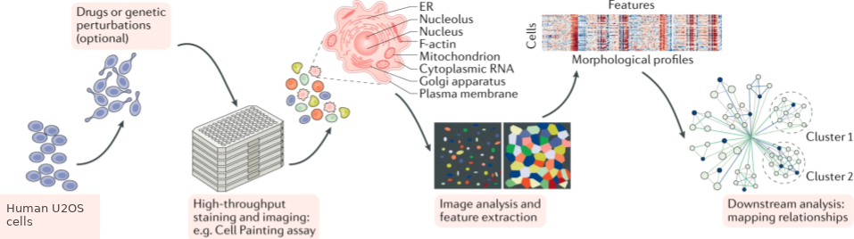
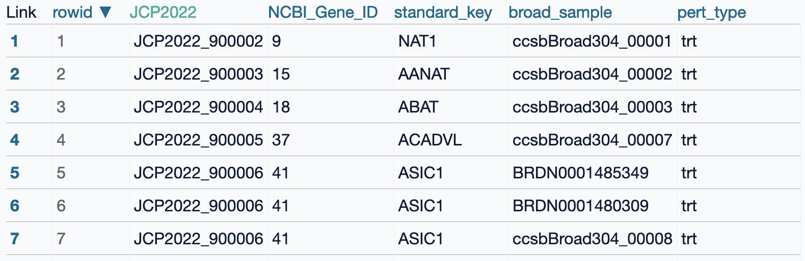
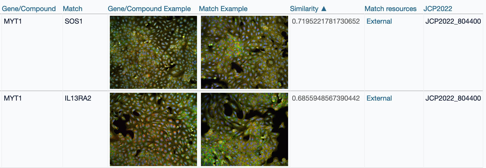
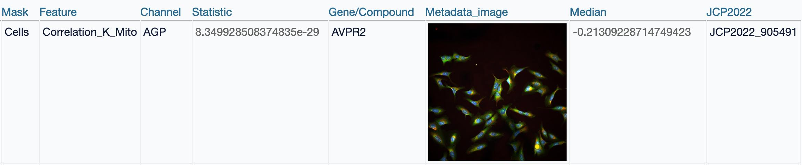
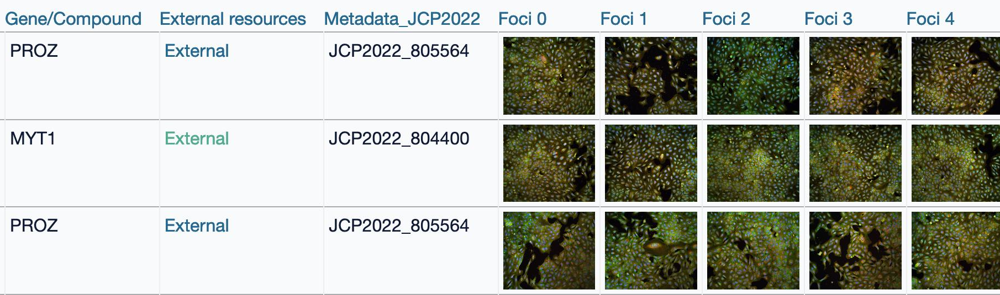
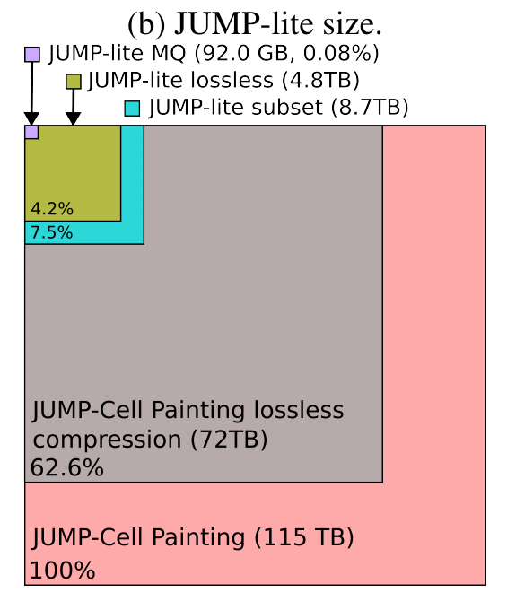

#+TITLE: Uncovering biological relationships through morphological profiling: The JUMP-Cell Painting dataset and tools
#+SUBTITLE: FASEB: Organelle Cross-Talk in Cellular Homeostasis
#+AUTHOR: Alán F. Muñoz
#+DATE: 21 October 2026
#+STARTUP: beamer
#+OPTIONS: H:2 toc:nil num:nil author:t date:t ^:nil
#+LATEX_CLASS: beamer
#+LATEX_COMPILER: xelatex
#+LATEX_CLASS_OPTIONS: [aspectratio=169,10pt]
#+BEAMER_THEME: moloch
#+LATEX_HEADER: \usepackage{fontspec}
#+LATEX_HEADER: \usepackage{array}
#+LATEX_HEADER: \setsansfont{FiraSans-Regular.otf}[BoldFont=FiraSans-Bold.otf,ItalicFont=FiraSans-Italic.otf,BoldItalicFont=FiraSans-BoldItalic.otf]
#+LATEX_HEADER: \AtBeginDocument{\AtBeginSection[]{}}
#+LATEX_HEADER: \institute{Carpenter-Shen Lab, Purdue University}
#+PROPERTY: header-args :eval never-export

# Conference: FASEB Organelle Cross-Talk in Cellular Homeostasis.
# Audience: biologists. Slot: 25 minutes, including a prerecorded demo.
# Planned pace: 23 minutes plus 2 minutes of buffer; see docs/presenter-notes.md.
# Keep slides direct and question-led. Interpretation limits belong in notes.
# Citations and figure credits are collected on the final References slide.
# Direct Overleaf edits take content priority: preserve and port them into Org.
# Edit deck/slides.org in the source repository; the Overleaf Org copy is one-way.

* Conference draft
** What is Cell Painting?
#+BEGIN_EXPORT latex
\begin{columns}[c,onlytextwidth]
\begin{column}{0.36\textwidth}
\begin{itemize}
\item A fluorescence microscopy assay for measuring cell morphology.
\item Six dyes reveal cellular structures across five imaging channels.
\item Shape, intensity and texture describe responses to genes and compounds.
\end{itemize}
\end{column}
\begin{column}{0.60\textwidth}
\centering
\includegraphics[width=0.98\linewidth,height=0.85\textheight,keepaspectratio]{assets/cell-painting-channels.png}
\end{column}
\end{columns}
#+END_EXPORT

# Speaker note: The five-channel-plus-merged panel from the I2K poster remains unchanged, including labels and scale bar.

** Cell Painting connects images to measurements
#+ATTR_LATEX: :width 0.99\linewidth :height 0.72\textheight :options keepaspectratio

- Stain and image cells, measure their appearance, and compare morphological profiles.

# Speaker note: The illustration is adapted for the JUMP context: its cell-source label now reads Human U2OS cells.
# Only that label changed; source and transformation are recorded in docs/assets.json.
# Similarity helps prioritize biological hypotheses; it does not establish mechanism.

** Why turn images into profiles?
Profiles summarize cellular appearance so we can compare and search large datasets.

#+BEGIN_EXPORT latex
\begin{columns}[T,onlytextwidth]
\begin{column}{0.48\textwidth}
\begin{block}{Engineered features: CellProfiler}
\begin{itemize}
\item Predefined measurements of size, shape, intensity, texture and spatial relationships.
\item Each feature has an explicit measurement definition.
\end{itemize}
\end{block}
\end{column}
\begin{column}{0.48\textwidth}
\begin{block}{Learned representations}
\begin{itemize}
\item Models learn visual features from training data using neural networks.
\item Images or cells are encoded as numerical feature vectors (embeddings).
\end{itemize}
\end{block}
\end{column}
\end{columns}
\medskip
\centering Compare perturbations $\cdot$ Group similar phenotypes $\cdot$ Prioritize follow-up
#+END_EXPORT

# Speaker note: Both routes produce vectors; cell/image features can be aggregated into well/perturbation profiles.
# Normalization, training objectives and experimental context affect comparisons. Retain images for inspection.
# Neither route alone establishes mechanism or removes batch effects. Do not claim one universally outperforms the other.

** JUMP: Joint Undertaking for Morphological Profiling
- A public Cell Painting dataset acquired across *12 laboratories*, covering nearly 139,000 chemical and genetic perturbations.

#+BEGIN_EXPORT latex
\begin{center}
\fbox{\parbox[c][29mm][c]{0.27\linewidth}{\centering CRISPR knockout\par\medskip{\Large\bfseries 7,975}\par gene targets}}
\quad
\fbox{\parbox[c][29mm][c]{0.27\linewidth}{\centering\small Transient open reading frame (ORF) overexpression\par\smallskip{\Large\bfseries $\sim$12,600}\par genes}}
\quad
\fbox{\parbox[c][29mm][c]{0.27\linewidth}{\centering Compound treatment\par\medskip{\Large\bfseries 115,794}\par compounds}}
\end{center}
#+END_EXPORT

- Researchers can use the images, measurements and metadata to investigate their own questions.
- Which gene, compound or phenotype from your lab would you like to explore?

# Speaker note: Counts use consortium metadata revision 016e865fa0691244e0860943e41c7d6a88ed2580, not JUMP-lite.
# Count distinct JCP2022 IDs present in wells, excluding negative-control and empty IDs; retain positive controls.
# Total 138,897 perturbation IDs. ORF: 15,128 constructs, 12,598 nonmissing annotated gene/locus IDs, rounded on the slide.
# Presenter requested genes only on the ORF card. The overall perturbation total is not the sum of gene-level card counts.
# Definitions and input hashes are in docs/jump-perturbation-counts.json.
# The principal dataset spans 12 data-generating centers. Its 13 Metadata_Source IDs include source_7 and source_13 from the same center.
# Verified in JUMP Hub data_description.md and terra_workspace.md at e742f5aa37472eb17f326ba8315d22b27e58f330; not every lab acquired every modality or perturbation.
# This merges the former audience-question slide into JUMP, keeping that question before the Hub overview.

** We make JUMP accessible via the JUMP Hub
#+BEGIN_EXPORT latex
\begin{columns}[c,onlytextwidth]
\begin{column}{0.58\textwidth}
\centering
\includegraphics[width=0.98\linewidth,height=0.82\textheight,keepaspectratio]{assets/jump-hub-homepage.png}
\end{column}
\begin{column}{0.39\textwidth}
\begin{itemize}
\item Does my gene or compound have a Cell Painting phenotype?
\item Which perturbations produce related phenotypes?
\item What changes in the cells and their organelles?
\item Which cell subpopulations stand out?
\end{itemize}
\end{column}
\end{columns}
#+END_EXPORT

# Speaker note: Complementary to the researcher's other methods, such as transcriptomics, as clarified in the presenter's reply to Anne.
# These are alternative entry points, not compulsory steps. Cell-subpopulation exploration is the separate notebook example.
# Availability is not phenotypic activity: use the perturbation-level corrected p-value to assess a detectable profile.
# Homepage captured 18 October 2026; other interface screenshots are historical examples.

** Was my gene or compound tested?
- Check whether your gene or compound is represented in JUMP.
- Choose the perturbation: knockout, overexpression or compound treatment.
- Open the associated profiles, images and experimental metadata.

#+ATTR_LATEX: :width 0.90\linewidth :height 0.42\textheight :options keepaspectratio

# Speaker note: Use the current availability tools for a new query. The illustration is an archived 2024 interface.

** Which perturbations produce related phenotypes?
*MYT1 example*

#+ATTR_LATEX: :width 0.93\linewidth :height 0.55\textheight :options keepaspectratio

- Explore the ranked matches to find candidates for follow-up.
- Export the filtered list with its details using the table's JSON link.

# Speaker note: JSON export is documented by the current JUMP_rr tutorial. Do not promise a CSV button.
# Profile similarity is not proof of a shared mechanism. This historical MYT1 example is separate from AVPR2 below.

** How does perturbing my gene change cell morphology?
*AVPR2 overexpression example*

#+ATTR_LATEX: :width 0.98\linewidth :height 0.47\textheight :options keepaspectratio

- A mitochondria--AGP overlap measurement stands out among the features.
- Follow up by comparing mitochondrial distribution relative to actin, Golgi and plasma-membrane staining.

# Speaker note: JCP2022_905491 maps to AVPR2 in the pinned ORF metadata, so the perturbation is overexpression.
# Screenshot: Cells / Correlation_K_Mito / AGP, normalized feature median -0.21309228714749423.
# The K overlap coefficient is intensity-dependent. Its normalized median is not a raw overlap fraction or a negative Pearson correlation.
# The screenshot does not establish a decrease in physical colocalization; do not repeat that unverified directional claim.
# Concrete next question: does the image pattern reflect mitochondrial redistribution, AGP changes, or intensity differences? Inspect replicates/controls.

** Use JUMP as a screen for your phenotype
#+BEGIN_EXPORT latex
\begin{columns}[T,onlytextwidth]
\begin{column}{0.46\textwidth}
\textbf{Measure many aspects of cell state}\par\medskip
\small
\begin{tabular}{@{}>{\raggedright\arraybackslash}p{0.32\linewidth}>{\raggedright\arraybackslash}p{0.60\linewidth}@{}}
\textbf{Size / shape} & Nuclear area, elongation \\[6pt]
\textbf{Intensity} & Mitochondrial staining \\[6pt]
\textbf{Texture} & Fine or coarse patterns \\[6pt]
\textbf{Correlation} & Relationships between channels \\[6pt]
\textbf{Distribution} & Peripheral or perinuclear signal
\end{tabular}
\end{column}
\begin{column}{0.50\textwidth}
\textbf{Which perturbations change nuclear size?}
\begin{itemize}
\item Select nuclear area in the feature table.
\item Rank perturbations by feature value and significance.
\item Inspect candidate images and compare replicate measurements.
\end{itemize}
\end{column}
\end{columns}
#+END_EXPORT

# Speaker note: Nuclear area corresponds to Nuclei_AreaShape_Area. This is a query recipe, not a claimed result list.
# Feature tables retain ranked subsets (top features/genes); use full profiles for an exhaustive screen.
# Keep perturbation-level activity distinct from per-feature significance. Check controls, batch effects and multiple testing.
# Mitochondrial staining intensity alone is not an absolute measurement of mitochondrial abundance.

** What do the perturbed cells look like?
*MYT1 and PROZ gallery examples*

#+ATTR_LATEX: :width 0.93\linewidth :height 0.55\textheight :options keepaspectratio

- Inspect cells across fields and imaging channels.
- Retrieve the images and relevant controls for a closer comparison.

# Speaker note: PROZ is not a negative-control label; the historical gallery is not a matched-control comparison.

** Ask an AI assistant to write your exploration notebook
#+BEGIN_QUOTE
Using the JUMP Hub documentation, write a notebook that links selected cells to their images and measurements. Include the source identifiers and save the analysis steps.
#+END_QUOTE

- The tools and documentation we build for researchers can also be used by AI agents.
- Biological expertise is essential for validating results.
- Robust, reproducible tools help agents use consistent methods across analyses.
- Extend the notebook with image models through nahual.

# Speaker note: Use an external AI assistant, not a built-in Hub chatbot. Generated code is a draft requiring verification.
# Presenter experience: without shared tools, agents may solve the same problem in different ways. Tested implementations, recorded parameters and versions support consistency; experts validate the biological interpretation.
# Stable identifiers and documented inputs/outputs support repeatable analysis. No claim that every AI/model supports this workflow.
# The following recorded marimo notebook is implemented; it is a separate single-cell example, not a gene/control study.

** Identify and explore cell subpopulations
*Interactive marimo notebook built from JUMP images and measurements*

#+BEGIN_EXPORT latex
\begin{center}
\href{https://doi.org/10.5281/zenodo.23462248}{\includegraphics[width=0.96\linewidth,height=0.51\textheight,keepaspectratio]{assets/demo-selection-545.png}}
\end{center}
#+END_EXPORT

- Each dot is one of 2,223 cells from a JUMP Target-2 plate.
- Select cells to update their images, area distribution and measurement summaries.
- [[https://doi.org/10.5281/zenodo.23462248][Watch the recorded demo (23 s) on Zenodo]].

# Playback cue: PDF page 13, visible slide number 12. Play jump-cell-interactivity.mp4 in a local player.
# The MP4 is a companion file, not embedded media. Narrate select -> inspect -> change channel -> reset -> select elsewhere.
# Public recording: https://doi.org/10.5281/zenodo.23462248 (CC BY 4.0). Both snapshot images and their demo links are clickable.
# Prefer local playback on stage; the public link is for later viewing.
# This still shows a 545-cell selection; the gallery samples six cells, not every selected cell.
# Notebook source: /work/users/amunoz/projects/jump-cell-browser-demo/notebook.py. No public notebook URL is asserted.
# If playback fails, use this still and the next slide without troubleshooting on stage.

** How do cells in another region compare?
*The same notebook, with a second selection*

#+BEGIN_EXPORT latex
\begin{center}
\href{https://doi.org/10.5281/zenodo.23462248}{\includegraphics[width=0.96\linewidth,height=0.51\textheight,keepaspectratio]{assets/demo-selection-224.png}}
\end{center}
#+END_EXPORT

- Select another region: 224 cells in this example.
- Compare cell images, areas and measurement summaries.
- [[https://doi.org/10.5281/zenodo.23462248][Watch the recorded demo (23 s) on Zenodo]].

# Speaker note: One plate, six wells, twelve fields; no treatment or control assignments.
# The reference is all loaded cells, including the selection. Feature-based selection changes distributions by construction.
# UMAP separation does not establish treatment effects or mechanism. Cells are not independent experimental replicates.
# The middle 50% is an interquartile range, not a confidence interval.
# Crops share pixel scale and fixed contrast; white outlines identify the selected objects, with some neighbors/truncation visible.
# This Target-2 Zstd example is separate from the main JUMP-lite release cohort.

** Develop and benchmark workflows with JUMP-lite
#+ATTR_LATEX: :width 0.96\linewidth :height 0.60\textheight :options keepaspectratio

- Use compact reference images to develop and compare computational methods.
- Test an analysis workflow before applying it to your own images.
- Connect reference data and measurement tools into an end-to-end analysis.

# Speaker note: Preserve the requested new-data framing. JUMP-lite supplies reference data, not a turnkey analysis engine.
# Explain dataset selection and smaller size, not codec/model infrastructure. Figure 1a,b is from the cited preprint.
# The preceding Target-2 recording is a separate subanalysis, not the main release cohort.

** Extract morphological profiles from your own images
#+BEGIN_EXPORT latex
\begin{columns}[c,onlytextwidth]
\begin{column}{0.44\textwidth}
\centering
\includegraphics[width=0.98\linewidth,height=0.66\textheight,keepaspectratio]{assets/cp-measure-paper.png}
\end{column}
\begin{column}{0.53\textwidth}
\textbf{cp\_measure: feature extraction in Python}
\begin{itemize}
\item Build profiles of thousands of features across channels and cell compartments.
\item Connect your own images and masks to downstream analysis in Python.
\item Intensity benchmark: 28$\times$ faster in v0.2.0 than v0.1.19.
\end{itemize}
\end{column}
\end{columns}
#+END_EXPORT

# Speaker note: Feature schema verified with five channels and three object types: 995 columns/object, 2,985 object-feature pairs when combined.
# That synthetic schema check disables Costes; aggregation/pivoting combines the API's object-type rows into a profile. Counts depend on configuration.
# Speed is the published median intensity-kernel speedup (28.07x), not a CellProfiler comparison or whole-pipeline speedup.
# Benchmark: synthetic 256/512/1024-pixel images, 16/64/256 objects, matched dependencies, single thread; cite the release report.

** Modern tools make image analysis more accessible
#+BEGIN_EXPORT latex
\begin{tabular}{@{}p{0.23\textwidth}p{0.72\textwidth}@{}}
\textbf{Segmentation} & Cellpose: masks for cells and nuclei. \\[0.65em]
\textbf{Profiles} & cp\_measure: images and masks $\rightarrow$ quantitative profiles. \\[0.65em]
\textbf{Tracking} & Trackastra for cells/nuclei; specialised trackers for organelles. \\[0.65em]
\textbf{Learned features} & Generalist and specialised models that can be fine-tuned. \\[0.65em]
\textbf{Data handling} & Parquet tables, Zarr arrays and JPEG XL image compression.
\end{tabular}\par\vspace{1.5em}
\centering\textbf{Agents reduce the friction of combining these tools into workflows.}
#+END_EXPORT

# Speaker note: This is a complementary toolbox, not a required five-step pipeline. Accessibility refers to image analysis, not the price of imaging hardware.
# Cellpose provides cell/nucleus segmentation. Trackastra links already segmented cells/nuclei in time-lapse data; do not claim it is validated for every organelle.
# Generalist/specialised learned representations can be adapted where model weights, training interfaces and licences permit; fine-tuning needs appropriate data and held-out evaluation.
# Parquet is columnar tabular storage, Zarr stores chunked multidimensional arrays, and JPEG XL is an image codec; they serve different roles.
# The agent-integration claim reflects the presenter's experience, not a measured speedup or a fully autonomous workflow. Experts validate the biology.
# Source links and credits are on the final References slide.

** From lysosomal probes to spatial omics
#+BEGIN_EXPORT latex
\begin{columns}[T,onlytextwidth]
\begin{column}{0.34\textwidth}
\begin{block}{Evaluate lysosomal probes}
\small Kenneth Li, University of Edinburgh\par
\normalsize
\begin{itemize}
\item Evaluate lysosomal acidification probes in cardiomyocytes.
\item Measure probe uptake, lysosomal localization and morphological changes over time.
\end{itemize}
\end{block}
\end{column}
\begin{column}{0.32\textwidth}
\begin{block}{Compare imaging modalities}
\small GSK collaboration\par
\normalsize
\begin{itemize}
\item Compare bright-field, Cell Painting, cell-cycle and viability readouts.
\item Identify shared and complementary compound responses across assays.
\end{itemize}
\end{block}
\end{column}
\begin{column}{0.30\textwidth}
\begin{block}{Connect to spatial omics}
\begin{itemize}
\item Integration of morphological features with Squidpy.
\end{itemize}
\end{block}
\end{column}
\end{columns}
\medskip
\centering Images and masks $\rightarrow$ Quantitative profiles $\rightarrow$ Biological questions
#+END_EXPORT

# Speaker note: The presenter confirmed that lysosomal-probe evaluation and Kenneth's cardiomyocyte work are the same project; they are one column.
# Kenneth's system/tasks are verified from the user-identified repository at 0bbf6c86aa51b1cd6c70b5b49485ae06cf875f93.
# No unpublished result, private microscopy figure, internal data URL, or efficacy claim is shown.
# Probe localization/intensity alone does not establish lysosomal pH; calibration, controls and spectral spillover matter.
# The GSK cross-modality workflow is verified from broadinstitute/gsk-ia at cf183a70f25174b9598136219314e7dcc8763e9e.
# Extraction includes Cell Painting, cell cycle, viability and bright-field time courses (with/without virtual staining).
# The concordance notebook compares active-compound sets and activity rankings across assays; no new concordance result or metric is claimed here.
# The spatial integration is supported by cp_measure's published Xenium/H&E/Squidpy example, not a built-in Hub capability.

** Take-home messages
- Morphological profiles provide a quantitative representation of cell state.
- We make JUMP data and query tools accessible to both researchers and AI agents.
- We are building the foundations for agent-driven workflows that connect new microscopy images to quantitative insights.
- Biological expertise is essential: experts remain in the loop to validate results.
- Robust, reproducible tools help agents use consistent methods across analyses.

# Speaker note: The presenter requested explicit take-home points on expert validation and reproducible tools.
# The first three retain the approved core messages; expert validation is separated from the third, and reproducible tools are added as the fifth.
# These are conclusions, not required workflow steps. Foundation-building is ongoing, not a claim of a fully autonomous validated system.
# Shared tools reduce variation in agent-chosen implementations; versioned inputs, parameters and biological validation still matter.

** Thank you
#+BEGIN_EXPORT latex
\centering
\includegraphics[width=0.20\linewidth,height=0.08\textheight,keepaspectratio]{assets/broad-logo.png}\hspace{0.07\linewidth}
\includegraphics[width=0.24\linewidth,height=0.08\textheight,keepaspectratio]{assets/purdue-logo.png}\par\smallskip
\includegraphics[width=0.98\linewidth,height=0.60\textheight,keepaspectratio]{assets/jump-partners.png}\par\medskip
{\small GSK provided part of the funding for this work.}\par
#+END_EXPORT

# Speaker note: Thank Broad, Purdue and the JUMP partners. The partner sheet is historical.
# Only JUMP prefixes were added to its headings; logos and collaborator entries are unchanged.
# Edinburgh is credited on Kenneth's application slide, not repeated here. Purdue remains the confirmed affiliation.
# The presenter requested separate gratitude and QR slides; advance to the QR page after thanking the contributors.

** Explore the projects and slides
#+BEGIN_EXPORT latex
\begin{columns}[T,onlytextwidth]
\begin{column}{0.23\textwidth}
\centering
\small\href{https://github.com/afermg/JUMP_lite}{JUMP-lite}\par\smallskip
\href{https://github.com/afermg/JUMP_lite}{\includegraphics[width=30mm]{assets/qr-jump-lite.png}}
\end{column}
\begin{column}{0.23\textwidth}
\centering
\small\href{https://broadinstitute.github.io/jump_hub/}{JUMP Hub}\par\smallskip
\href{https://broadinstitute.github.io/jump_hub/}{\includegraphics[width=30mm]{assets/qr-jump-hub.png}}
\end{column}
\begin{column}{0.23\textwidth}
\centering
\small\href{https://github.com/afermg/cp_measure}{cp\_measure}\par\smallskip
\href{https://github.com/afermg/cp_measure}{\includegraphics[width=30mm]{assets/qr-cp-measure.png}}
\end{column}
\begin{column}{0.23\textwidth}
\centering
\small\href{https://github.com/afermg/2026_10_21_faseb_jump_hub/blob/main/slides.pdf}{Slides (PDF)}\par\smallskip
\href{https://github.com/afermg/2026_10_21_faseb_jump_hub/blob/main/slides.pdf}{\includegraphics[width=30mm]{assets/qr-slides.png}}
\end{column}
\end{columns}
\medskip
\centering\small\href{https://doi.org/10.5281/zenodo.23462248}{Watch the recorded demo (23 s) on Zenodo}
#+END_EXPORT

# Speaker note: Leave this dedicated QR slide visible at the end. The four QR destinations are unchanged; the codes remain 30 mm.
# The separate text link opens the public Zenodo recording, DOI 10.5281/zenodo.23462248 (CC BY 4.0).
# The fourth QR targets the GitHub PDF viewer in afermg/2026_10_21_faseb_jump_hub, branch main, slides.pdf.
# The repository remains private until the presenter explicitly authorizes making it public. The PDF must not be uploaded until final approval.
# The QR is prepared but the PDF is intentionally absent; public audience access also requires the separate visibility approval. Do not expose other private projects.
# Briefly show references if useful, then return here.

** References
#+BEGIN_EXPORT latex
\begin{columns}[T,onlytextwidth]
\begin{column}{0.31\textwidth}
\small
\textbf{Assay and data}
\begin{itemize}
\item \href{https://doi.org/10.1038/nprot.2016.105}{Bray et al. (2016). Cell Painting.}\newline Nature Protocols.
\item \href{https://doi.org/10.1038/s41573-020-00117-w}{Chandrasekaran et al. (2021).}\newline Image-based profiling. Nature Reviews Drug Discovery.
\item \href{https://jump-cellpainting.broadinstitute.org/}{JUMP consortium}; \href{https://github.com/jump-cellpainting/datasets/tree/016e865fa0691244e0860943e41c7d6a88ed2580/metadata}{perturbation counts}; \href{https://github.com/broadinstitute/jump_hub/blob/e742f5aa37472eb17f326ba8315d22b27e58f330/explanations/data_description.md}{12 centers}.
\item \href{https://doi.org/10.1186/gb-2006-7-10-r100}{Carpenter et al. (2006). CellProfiler.}\newline Genome Biology.
\item Data formats: \href{https://parquet.apache.org/}{Parquet}, \href{https://zarr.dev/}{Zarr}, \href{https://jpeg.org/jpegxl/}{JPEG XL}.
\end{itemize}
\end{column}
\begin{column}{0.32\textwidth}
\small
\textbf{Analysis toolbox}
\begin{itemize}
\item \href{https://arxiv.org/abs/2608.07632v3}{Muñoz et al. (2026). JUMP-lite, Fig. 1a,b.}\newline \href{https://github.com/afermg/JUMP_lite}{Data and documentation}.
\item \href{https://arxiv.org/abs/2507.01163v1}{Muñoz et al. (2025). cp\_measure, Fig. 1.}\newline \href{https://github.com/afermg/cp_measure}{Code}; \href{https://github.com/afermg/cp_measure/blob/6ffe85e0e7111f4599ec5c884542a69bbbb9dc42/benchmarks/releases/v0.2.0.md}{v0.2.0 speed benchmark}.
\item \href{https://github.com/MouseLand/cellpose}{Cellpose}: cell/nucleus segmentation.
\item \href{https://github.com/weigertlab/trackastra}{Trackastra}: cell tracking.
\item \href{https://github.com/afermg/nahual}{nahual}: image-model interfaces.
\item \href{https://squidpy.readthedocs.io/}{Squidpy}: spatial molecular and image analysis.
\end{itemize}
\end{column}
\begin{column}{0.31\textwidth}
\small
\textbf{Resources and credits}
\begin{itemize}
\item \href{https://broadinstitute.github.io/jump_hub/}{JUMP Hub}: \href{https://broadinstitute.github.io/jump_hub/howto/interactive/1_jumprr_steps.html}{biological questions and table export}.
\item Recording: \href{https://github.com/afermg/JUMP_lite/blob/main/cpg_upload/TARGET2_ARTIFACTS_README.md}{JUMP Target-2 artifacts}.
\item \href{https://github.com/afermg/2024_05_JUMPTools_CellCircuits}{Cell Circuits (2024)}: Hub images, Broad/JUMP logos.
\item \href{https://github.com/afermg/2024_10_i2k_poster_flashtalk}{I2K (2024)}: channels and adapted profiling illustration.
\item \href{https://www.purdue.edu/brand/visual-identity/logo/}{Purdue University}: official logo.
\end{itemize}
\end{column}
\end{columns}
#+END_EXPORT
